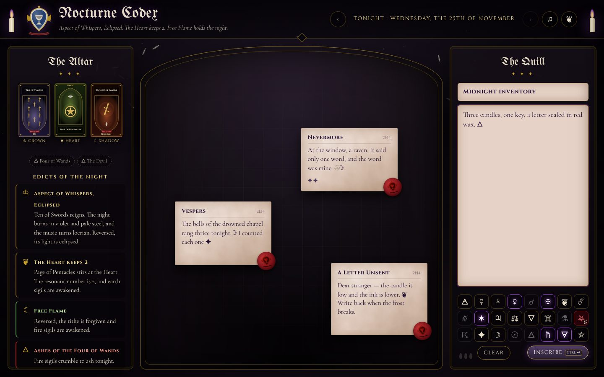
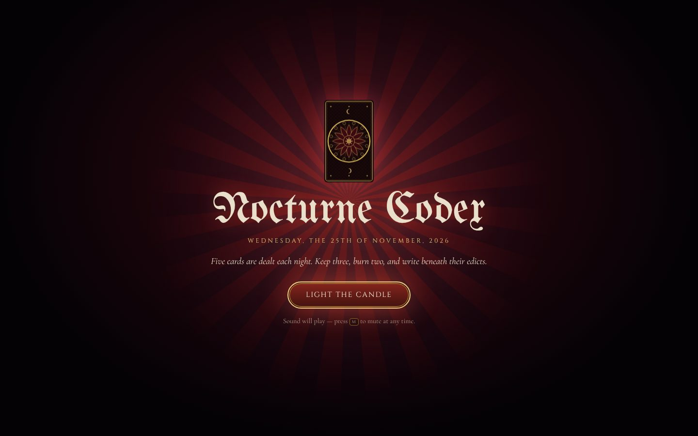
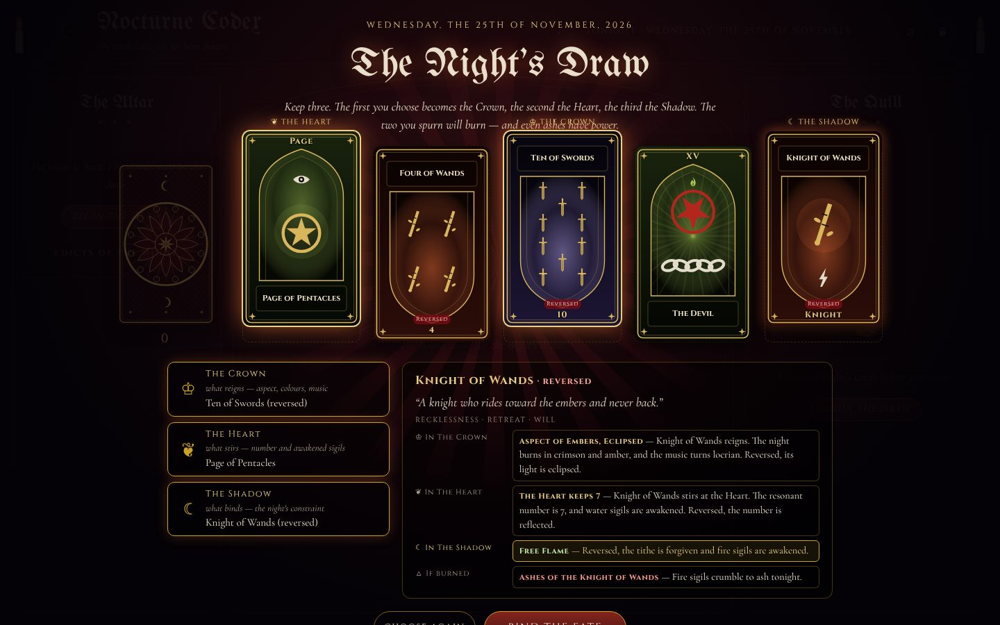
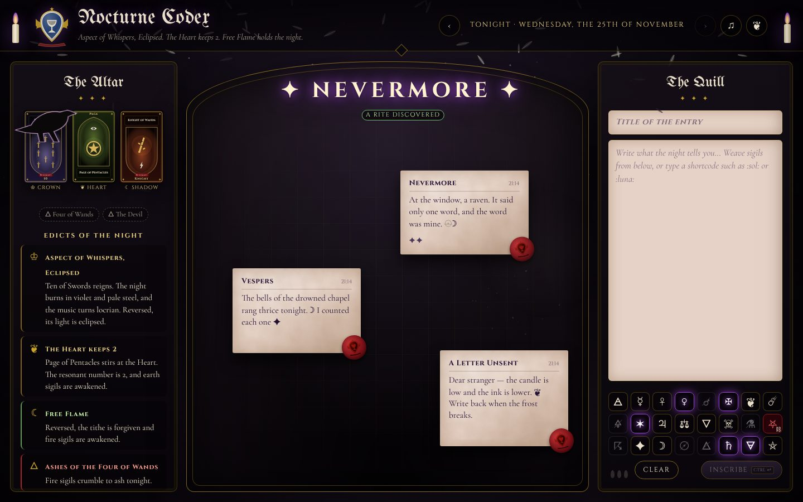
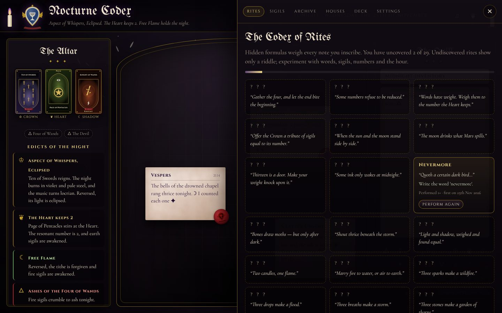

<div align="center">

# 🕯 Nocturne Codex

**A gothic grimoire for the hours after dusk.**<br>
Each night you draw five tarot cards, keep three and burn two. The cards rewrite the rules of
the board; the sigils you weave into your notes awaken hidden rites, with their own animations and sounds.



</div>

---

## Open it in one click

The Codex is a small local app: a Python program serves a page to **your own browser**, and
nothing ever leaves your computer. It needs **Python 3.9 or newer and nothing else** — no
`pip install`, no internet connection.

| Your computer | Do this |
|---|---|
| **Windows** | Double-click **`Open Nocturne Codex.bat`** |
| **macOS** | Double-click **`Open Nocturne Codex.command`** (the very first time: right-click → *Open*) |
| **Linux** | Double-click or run **`./open-nocturne-codex.sh`** |
| **Anywhere** | `python launch.py` — or `python -m nocturne` from this folder |

A browser tab opens at <http://127.0.0.1:6613/>. To close the Codex, close the little terminal
window, press <kbd>Ctrl</kbd>+<kbd>C</kbd> in it, or choose **Settings → Snuff the candle**.
Opening the launcher again while the Codex is running simply brings its page back.

> No Python yet? Install it from [python.org/downloads](https://www.python.org/downloads/)
> (on Windows tick **“Add python.exe to PATH”**), then double-click the launcher again.

---

## The nightly ritual

| | |
|---|---|
|  | **1 · Light the candle.** The threshold greets you with the date. Lighting the candle wakes the choir: an ambient organ, wind and distant bells, all synthesised live in the night's musical mode. |
|  | **2 · Draw five, keep three.** Touch the deck five times (or press <kbd>Space</kbd>). Fate shuffled it long before you came: the hand is fixed for the day and different every day. Hover a card to read it and see exactly what it would decree in each position. The first card you keep becomes **the Crown**, the second **the Heart**, the third **the Shadow**. The two you spurn **burn**, and their ashes still have power. |
|  | **3 · Write beneath the edicts.** The kept cards set the night's colours, particles and music, a *resonant number*, which sigils are **awakened**, and a constraint such as a *Vow of Brevity* or *Weight of Stone*. Inscribe notes with sigils (☉ ☽ ☿ ♀ ♂ 🜂 🜄 🜁 🜃 ✠ ☠ …). When your words and sigils satisfy one of the **hidden formulas**, a rite is performed: an eclipse, a blood moon, the thirteenth toll, a raven that says *nevermore*, thorns, starfall, an ouroboros… |
|  | **4 · Uncover the rites.** Twenty-nine rites hide in the Codex. Undiscovered ones show only a riddle. When you perform one for the first time its secret is written into **the Tome**. |

Every night is sealed at midnight: its cards, its House, its colours and its notes stay
exactly as they were. Walk back through past nights with <kbd>←</kbd>/<kbd>→</kbd> or the
**Archive**. Tomorrow brings a new hand.

## What is inside

- **A full 78-card tarot deck** with original gothic card art, drawn as SVG by the program
  itself. The twenty-two Major Arcana each carry an *arcanum*, a signature mechanic: the
  Hermit's lantern darkness, the Star's constellation of notes, the Tower's quaking board, the
  Devil's pact that forbids sigils, the Moon's wavering ink and endless witching hour, and more.
- **Edicts that really change the app.** Character limits, required sigils, anchored notes,
  veiled or fading notes, a mirrored title, a scrambled sigil palette, a velocity gauge, an
  echo of a past note returning to the board, gilded light, illuminated initials…
- **Twenty-four sigils** with elements, polarities and numeric values. Click them in the Quill
  or type shortcodes such as `:sol:` and `:luna:`. Awakened, banished, forbidden and wild
  sigils glow, crumble or chain accordingly.
- **Hidden formulas** that weigh letters (A=1 … Z=26), sigil sequences, sums, palindromes,
  primes, the hour and even your writing speed, all bent by the night's cards.
- **Thirty animations and nearly forty synthesised sounds**: bells with inharmonic partials, a
  cathedral reverb, fire crackle, thunder, ravens' wings, chains and choirs, all made from
  oscillators and noise. Nothing is recorded.
- **Twelve heraldic Houses** with procedurally drawn crests; one presides over each night
  and seals every note in red wax. **The Forge** turns any name into a personal crest.
- **A draggable parchment board**, a reading voice that recites notes (and names their
  sigils), an archive of nights, JSON and Markdown export, and keyboard shortcuts throughout.

## Private by design

- Notes live in one SQLite file in your user data folder, shown in **Settings**:
  - Windows: `%APPDATA%\NocturneCodex`
  - macOS: `~/Library/Application Support/NocturneCodex`
  - Linux: `~/.local/share/NocturneCodex`
  - Set the `NOCTURNE_HOME` environment variable, or pass `--data-dir`, to use another folder.
- The server listens on `127.0.0.1` only, checks the `Host` header to defeat DNS rebinding, and
  requires a secret token (minted at every launch and embedded only in its own page) for every
  API call. Other websites cannot read or write your notes.
- A strict Content-Security-Policy forbids external scripts, fonts and requests. The fonts are
  bundled and the page never calls the outside world.
- **Veil every note** (Settings) blurs notes until you hover over them.
- Each Codex holds its own random *soul secret*, so your nightly hands are yours alone.

## Keys

| Key | Does |
|---|---|
| <kbd>Ctrl</kbd>/<kbd>⌘</kbd> + <kbd>Enter</kbd> | Inscribe the note |
| <kbd>Space</kbd> | Draw a card during the ritual |
| <kbd>M</kbd> | Mute / unmute |
| <kbd>T</kbd> | Open / close the Tome |
| <kbd>←</kbd> <kbd>→</kbd> | Walk between nights |
| <kbd>/</kbd> | Take up the quill |
| <kbd>Esc</kbd> | Close what is open |

## Documentation

- **[User guide](docs/USER_GUIDE.md)**: every screen, button and setting.
- **[Mechanics](docs/MECHANICS.md)**: the positions, every card's effect, every sigil.
- **[Architecture](docs/ARCHITECTURE.md)**: how the code fits together, the HTTP API and the security model.
- **[Forbidden Lore](docs/FORBIDDEN_LORE.md)**: ⚠ *every hidden formula, spoiled.* Read only if you would rather know than wonder.

## Command line

```text
python -m nocturne [--port 6613] [--host 127.0.0.1] [--data-dir PATH] [--no-browser] [--verbose] [--version]
```

Or install it as a command with `pip install .`, then run `nocturne`.

## Development

```bash
python -m pip install -e ".[dev]"     # pytest, pytest-cov, ruff
python -m pytest                      # 300+ tests: engine, formulas, storage, HTTP API, security, front-end parity
python -m pytest --cov=nocturne       # ~97% coverage
ruff check . && ruff format --check . # lint and formatting
for f in nocturne/static/js/*.js; do node --check "$f"; done   # front-end syntax
```

Continuous integration (`.github/workflows/ci.yml`) runs the linters, the JavaScript syntax
check and the full test suite on Python 3.9–3.13 on Linux, and on Windows and macOS.

```text
nocturne/
├── cli.py, __main__.py   launcher: finds a port, opens the browser, reuses a running Codex
├── server.py             stdlib HTTP server: routing, token, Host & Origin checks, CSP
├── codex.py              application logic behind every endpoint
├── storage.py            the private SQLite store
├── rng.py                portable deterministic randomness (SHA-256 counter mode)
├── tarot.py              the 78 cards       ritual.py   draw five, keep three
├── edicts.py             how the cards rewrite the rules (the rules engine)
├── arcane.py             the hidden formulas and the 29 rites
├── sigils.py             the 24 sigils      numerology.py  letter weights and roots
├── heraldry.py           the 12 Houses and the crest forge
├── cardart.py, glyphs.py procedural SVG art for cards and emblems
└── static/               the page: HTML, CSS, ES modules (audio, fx, ritual, board, quill, tome), fonts
tests/                    pytest suite
docs/                     guides and screenshots
```

## Credits

All code, card art, crests, sounds and text were written for this project. The bundled fonts
(UnifrakturMaguntia, Cinzel, Cormorant Garamond and subsets of Noto Sans Symbols) are used
under the SIL Open Font License; see `nocturne/static/fonts/OFL.txt`.
