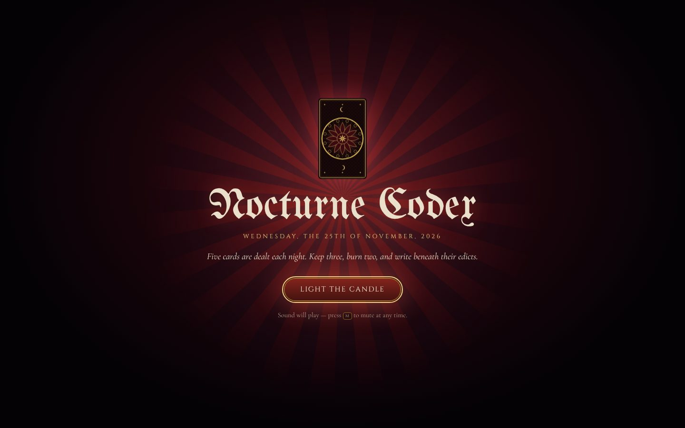
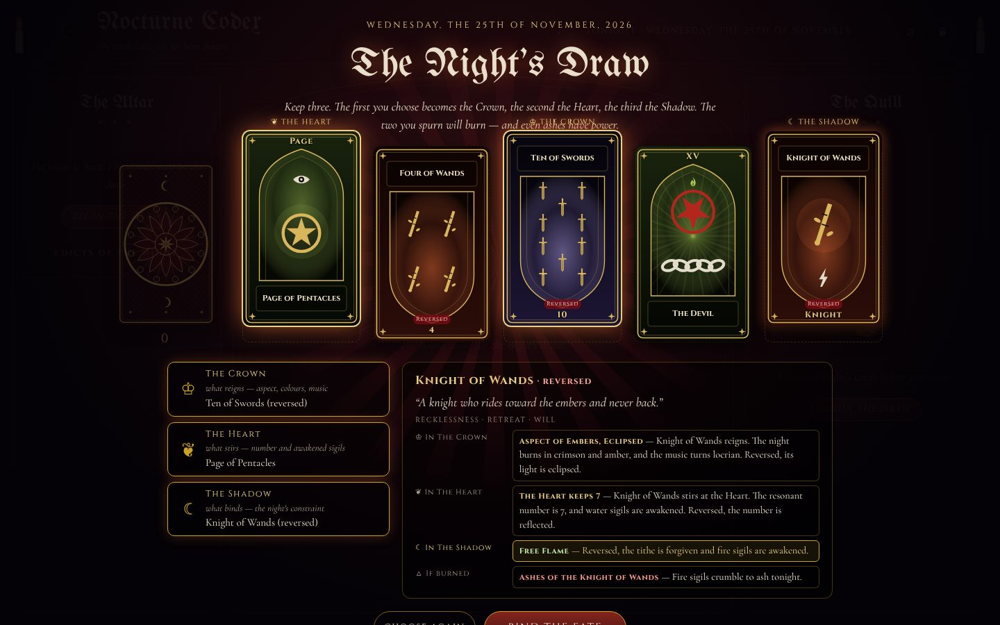
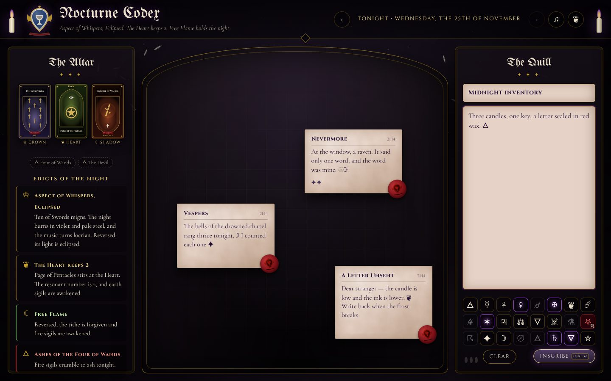

# User guide

A walk through every screen of the Nocturne Codex.

## Opening and closing

| Your computer | Open | Close |
|---|---|---|
| Windows | Double-click `Open Nocturne Codex.bat` | Close the black window, or **Settings → Snuff the candle** |
| macOS | Double-click `Open Nocturne Codex.command` (first time: right-click → *Open*, because the file is not signed) | Close the Terminal window, or snuff the candle |
| Linux | `./open-nocturne-codex.sh` | <kbd>Ctrl</kbd>+<kbd>C</kbd> in the terminal, or snuff the candle |
| Any | `python launch.py` or `python -m nocturne` | <kbd>Ctrl</kbd>+<kbd>C</kbd> |

The launcher starts a small server on your own computer and opens your browser at
`http://127.0.0.1:6613/` (or the next free port). If the Codex is already open, the launcher
simply shows its page again.

## 1 · The threshold

The welcome screen shows tonight's date. **Light the Candle** starts the sound: browsers only
allow audio after you click something. If you have forged a crest (see *Houses*), it is shown
here with a greeting.

## 2 · The night's draw

1. **Draw.** Click the deck, or press <kbd>Space</kbd>, five times. Each card flies out and turns over.
   A red *Reversed* tag marks a card that fell upside down.
2. **Read.** Hover over (or focus) a card. The Oracle shows its epigraph and keywords, and what
   it would decree **in the Crown, in the Heart, in the Shadow, or if burned**. The highlighted
   row is the position it would take if you chose it next.
3. **Keep three.** Click the cards in order: the first becomes **the Crown**, the second **the
   Heart**, the third **the Shadow**. Click a chosen card again to release it, or press **Choose
   again** to start over.
4. **Bind the Fate.** The two spurned cards burn. The kept ones take their thrones, the board
   changes its colours and music, and the edicts are read out one by one.

The ritual can be performed once a night. If you close the page midway, the same five cards
will be waiting.

## 3 · The Sanctum

### The crown bar

* **The crest** of the presiding House.
* **The omen**: a one-line summary of the night.
* **‹ date ›**: walk to the previous or next night (<kbd>←</kbd> <kbd>→</kbd>). Click the date to
  open the Archive. **Tonight** jumps back to the present.
* **♫**: mute or unmute (<kbd>M</kbd>). **❦**: the Tome (<kbd>T</kbd>).

### The Altar (left)

Your three kept cards (click one for its full reading and what it decrees tonight), the ashes
of the two you burned, the **Edicts of the Night** (gold = omen, green = boon, red = bane) and
the presiding House.

### The board (centre)

Every note of the night pinned on dark stone, sealed in red wax with the House's crest.

* **Click** a note to open it.
* **Drag** a note to move it, unless tonight's notes are *anchored*.
* Stars beside the title (✦) count the rites a note performed; ⛓ marks a note bound in chains.
* Some nights change the board: veiled or fading notes, drifting notes, a quaking board, a
  lantern that lights only what lies under your cursor, a constellation drawn from your notes,
  or an *echo*, a ghostly note returned from a past night.

### The Quill (right)

* **Title** and **body**. Type `:sol:`, `:luna:`, `:fire:` … and the shortcode becomes its sigil.
* **The meters** show tonight's edicts live: ✓ when satisfied, ✗ when not.
* **The sigil palette.** Click to inscribe at the cursor. Hover for the name, shortcode and
  lore.
  * glowing = **awakened** (rites using it are stronger)
  * grey and struck through = **banished** (crumbles to ash, counts for nothing)
  * red with ⛓ = **forbidden** (binds the note in chains)
  * shifting colours = **wild** (counts as every element)
* **The omen candle** (three small flames) flares as your draft approaches a rite: one flame per
  rite it would perform. It never says which.
* **Inscribe** (<kbd>Ctrl</kbd>/<kbd>⌘</kbd>+<kbd>Enter</kbd>). The note unfurls on the board, the
  wax seal falls, and any rites are performed. A rite you have never performed before is
  announced as *discovered* and its secret is written into the Tome.

## 4 · A note, opened

* **Recite** reads the note aloud in a low voice, naming each sigil. Choose the voice in Settings.
* **Replay rites** performs the note's rites again.
* **Edit** (tonight only, and never for a bound note) loads it back into the Quill.
* **Burn** deletes it forever. On nights of Death, it leaves as a cloud of moths.

## 5 · The Tome

| Tab | Holds |
|---|---|
| **Rites** | The Codex of Rites: a riddle for each undiscovered rite; the full secret, count and first night for each discovered one, with **Perform again**. |
| **Sigils** | All 24 sigils with element, polarity, value, shortcode and tonight's state. |
| **Archive** | Every observed night with its House, kept cards, aspect and number of notes. Click to visit. |
| **Houses** | The twelve Houses and their crests. **The Forge** turns any name into a personal crest; *Bear this crest* puts it on the threshold. |
| **Deck** | All 78 cards. Click any card for its reading. |
| **Settings** | Volume, ambient organ, rite sounds, quill sounds, *Stillness* (calm animations), *Veil every note*, the reciting voice, export, where your notes live, and *Snuff the candle*. |

## 6 · Past nights

Past nights are sealed. Visiting one restores its colours, House and notes exactly as they
were. You may read, recite, replay and burn its notes, but its ink has dried: no new notes and
no edits.

## 7 · Export and backup

**Settings → Export as JSON / Markdown** downloads everything. To back up or move a Codex,
copy the file `codex.sqlite3` from the data folder shown in Settings. It also holds your soul
secret, so your nightly hands travel with it.

## Troubleshooting

| Problem | Remedy |
|---|---|
| *“Python was not found”* on Windows | Install Python from python.org and tick **Add python.exe to PATH**, or use the `py` launcher. |
| macOS refuses to open the `.command` file | Right-click → *Open* once, or run `chmod +x "Open Nocturne Codex.command"` if it lost its permission. |
| The port is busy | The Codex picks the next free port automatically; the terminal shows the address. You can also pass `--port 7000`. |
| No sound | Click the page once (browsers need a gesture), check the ♫ button and the volume in Settings. |
| Animations are too much | Turn on **Stillness** in Settings (your system's *reduce motion* preference is also honoured). |
| I want my notes elsewhere | Set `NOCTURNE_HOME=/path/to/folder` or run `python -m nocturne --data-dir /path/to/folder`. |
